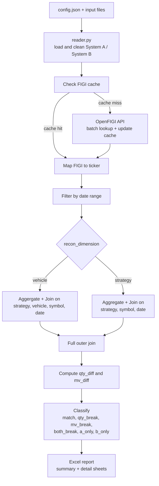

# Interval Partners 
# Position Reconciliation Engine

**Technical Documentation**

---
## Table of Contents

1. Overview
2. System Architecture and Data Flow
3. Module Reference
4. Configuration Reference
5. Identifier Mapping Design
6. Reconciliation Logic
7. Output Format
8. Setup and Execution
9. Known Limitations
10. Future Improvements

---
## 1. Overview

This engine reconciles position holdings between two independent systems (System A and System B) that report the same universe of securities but use different file formats and identifier schemes. System A identifies securities by FIGI (Financial Instrument Global Identifier). System B identifies securities by ticker symbol. The engine resolves this mismatch using OpenFIGI, aligns the data, and surfaces any quantity or market value breaks between the two systems.

**Key capabilities:**
- Ingests CSV (System A) and JSON (System B) source files
- Resolves FIGI-to-ticker mappings via the OpenFIGI API with a persistent local cache and API raw response for audit trail.
- Supports two reconciliation dimensions: vehicle-level (fine-grained) and strategy-level (aggregated)
- Classifies every position as matched, quantity break, market value break, both break, or orphan
- Produces a multi-sheet Excel report structured for a risk analyst audience

---
## 2. System Architecture and Data Flow 

The engine is organized data pipeline with six discrete modules, each handling a single responsibility. No module reads files that another module is responsible for, and no business logic exists in the orchestrator.



**Module inventory:**

| Module          | File                 | Responsibility                                                                                                             |
| --------------- | -------------------- | -------------------------------------------------------------------------------------------------------------------------- |
| Config Loader   | `config_loader.py`   | Load and validate `config.json`, enforce required keys                                                                     |
| Reader          | `reader.py`          | Read System A (CSV) and System B (JSON), normalize column names, enforce types, strip whitespace, flag invalid identifiers |
| OpenFIGI Client | `openfigi_client.py` | Batch API calls to OpenFIGI v3, retry with exponential backoff, rate limit handling                                        |
| Cache           | `cache.py`           | Build, load, save, and query the FIGI-to-ticker mapping cache                                                              |
| Reconciler      | `recon.py`           | Enrich, filter, aggregate, join, compute diffs, classify breaks                                                            |
| Excel Writer    | `excel_writer.py`    | Write multi-sheet formatted Excel workbook                                                                                 |
| Utilities       | `utils.py`           | Shared constants (`COL_NAMES` mapping) and reusable helpers (`normalize_df`)                                               |
| Orchestrator    | `main.py`            | Wire modules together in sequence; contains no business logic                                                              |

---

## 3. Module Reference

1. **`config_loader.py`**
It loads `config.json` and then validates all required keys are present. It has been made to fail fast if required config keys are missing.
**Required config keys:** `openfigi_api_key`, `system_a_file`, `system_b_file`, `recon_dimension`, `start_date`, `end_date`, `output_file`

2. **`reader.py`**
Reads the System A and System B 
System A additionally flags rows with empty or null FIGIs via the `isValidFigi` boolean column. These rows are not dropped they flow through the pipeline and are excluded from reconciliation at the join stage, preserving full data visibility.

3. **`openfigi_client.py`**
Encapsulates all communication with the OpenFIGI v3 API
**Retry strategy:** Uses `urllib3.util.Retry` mounted on an `HTTPAdapter` for automatic retry with exponential backoff. This is the standard `requests` library pattern which is configurable.

| Parameter          | Value                   | Rationale                              |
| ------------------ | ----------------------- | -------------------------------------- |
| `total`            | 3                       | Three retries before failing a batch   |
| `backoff_factor`   | 1                       | Wait 1s, 2s, 4s between retries        |
| `status_forcelist` | 429, 500, 502, 503, 504 | Rate limit and transient server errors |
| `allowed_methods`  | POST                    | Required since OpenFIGI uses POST      |
| `timeout`          | 30s                     | Per-request timeout to prevent hanging |

**Batch processing:** OpenFIGI only allows up to 100 FIGIs per request. The client batches the requests and logs progress per batch. We take 0.25 second pause between batches reduces the likelihood of triggering rate limits before they happen.

**Error contract:** Failed batches do not crash the pipeline. Instead, error placeholder dicts `{"figi": "...", "error": "..."}` are inserted to maintain 1:1 positional alignment between input FIGIs and response items {errors}. Downstream modules (cache.py) check for the `"error"` key and skip these entries.

4. **`cache.py`**
	`cache.py` creates the figi-symbol map for reference join in `recon.py` 
- `create_ticker_map(file_path, existing_cache=None)`: This builds figi, ticker mapping from a raw OpenFIGI response file. Merges into an existing cache if provided. Handles single-result and multi-result API responses 

**Multi-result filtering logic:** When a FIGI returns multiple records from the API (e.g., dual-listed securities), the cache applies a tie-breaking filter:

1. Single result then accept directly
2. Multiple results then prefer `exchCode="US"` and `securityType="Common Stock"`
3. No match after filter then fall back to first result with a logged warning

This filtering only triggers when ambiguity exists. For the current dataset, all 132 FIGIs return a single unambiguous result.

5. **`recon.py`**
Single entry point: `reconcile(sys_a, sys_b, cache, config)`

6. **`excel_writer.py`**
Single entry point: `write_excel(recon_results, config)`

7. **`utils.py`**
Contains the canonical `COL_NAMES` mapping dictionary  and `normalize_df()` which applies column rename, type enforcement, and whitespace stripping; used by `readers.py`

---
## 4. Configuration Reference

All runtime parameters are driven by `config.json`. No values are hardcoded in the engine logic.

```json
{
  "openfigi_api_key": "YOUR_API_KEY_HERE",
  "recon_dimension": "vehicle",
  "start_date": "2025-02-05",
  "end_date": "2026-03-20",
  "output_file": "output/recon_results.xlsx",
  "system_a_file": "data/system_a/system_a_posns.csv",
  "system_b_file": "data/system_b/system_b_posns.json",
  "cache_file": "data/mappings/figi_cache.json",
  "inspect_file": "data/mappings/raw_response.json",
  "tolerance_market_value": 0.01
}
```

| Key                      | Type   | Description                                                                                                                                          |
| ------------------------ | ------ | ---------------------------------------------------------------------------------------------------------------------------------------------------- |
| `openfigi_api_key`       | string | API key for OpenFIGI                                                                                                                                 |
| `recon_dimension`        | string | `"vehicle"` or `"strategy"`. Controls reconciliation grain. Vehicle mode joins per-vehicle. Strategy mode aggregates across vehicles before joining. |
| `start_date`             | string | ISO format date (YYYY-MM-DD). Positions before this date are excluded.                                                                               |
| `end_date`               | string | ISO format date (YYYY-MM-DD). Positions after this date are excluded.                                                                                |
| `output_file`            | string | Path for the output Excel file. Directories are created if needed.                                                                                   |
| `system_a_file`          | string | Path to the System A CSV input file.                                                                                                                 |
| `system_b_file`          | string | Path to the System B JSON input file.                                                                                                                |
| `cache_file`             | string | Path to the persistent FIGI-to-ticker cache (JSON)                                                                                                   |
| `inspect_file`           | string | Path where raw OpenFIGI API responses are saved for audit.                                                                                           |
| `tolerance_market_value` | float  | Absolute threshold for market value breaks. Diffs at or below this value are classified as matched. Default: 0                                       |

---

## 5. Identifier Mapping Design
#### Resolution Strategy
The engine enriches System A with ticker symbols by resolving FIGIs via the OpenFIGI API. System B already has ticker symbols natively. The cache is `{figi: ticker}`. Mapping directly onto System A requires no reversal. Additionally, if the test dataset contains a ticker in System B that has no corresponding FIGI in System A, the outer join catches it naturally as a System B orphan.
#### Cache-First Lookup
```
For each unique FIGI in System A:
  1. Check figi_cache.json
     if FIGI exist in cache, use it, no API Calls 
     if FIGI missing then add to batch list for API Calls 
  2. Batch all misses into API calls (max 100 per request)
  3. Parse responses, extract ticker
  4. Update cache with new mappings
  5. Save cache to disk
```
#### Handling API Response Ambiguity
The OpenFIGI API can return multiple records per FIGI when a security is listed on multiple exchanges. The engine applies a cascading filter:

1. **Single result**: Accept directly. No filtering needed. (This is the case for all 132 FIGIs in the sample dataset.)
2. **Multiple results**: Filter to `exchCode="US"` and `securityType="Common Stock"`.
3. **No match after filter**: Fall back to the first result and log a warning.

Ensuring no FIGI is silently dropped. Non-US securities still resolve via the fallback path, and all ambiguous cases are logged for review.
#### Raw Response Audit Trail
Every API response is saved as-is to `raw_response.json` (path configurable). This provides a complete audit trail of what the API returned, separate from the processed cache. If the filtering logic changes or needs debugging, the raw data is available for reprocessing without additional API calls.

---

## 6. Reconciliation Logic
### Reconciliation Dimensions
The engine supports two modes, controlled by the `recon_dimension` config parameter:
1. **Vehicle mode**: Positions are first normalized to the reconciliation grain `(strategy, vehicle, symbol, date)` by summing quantity and market value, then reconciled at that level. This prevents many-to-many join inflation when duplicate raw rows exist for the same security within a vehicle on a given date.
2. **Strategy mode**: Positions are aggregated across all vehicles within each strategy to `(strategy, symbol, date)`, then reconciled at that level.

**Analyst view:** Vehicle-level reconciliation provides granular visibility into where a discrepancy occurs, while strategy-level reconciliation provides a higher-level net exposure view where breaks across vehicles may offset.
### Join Strategy
The engine uses a *full outer join* to ensure:
- Positions in both systems: compared and classified
- using `indicator=True` in pd.merge 
	- left_only maps to Positions only in System A  (`system_a_only`)
	- right_only maps to Positions only in System B(`system_b_only`)
	- both maps to math or break cases 
### Break Classification
After the join, two diff columns are computed:
- `qty_break = quantity_a (fillna 0) - quantity_b (fillna 0)`
- `mv_break = market_value_a (fillna 0) - market_value_b (fillna 0)`

Each row is then classified using vectorized boolean masks:

| Status          | Condition                                                          |
| --------------- | ------------------------------------------------------------------ |
| `matched`       | In both systems, `qty_break == 0` AND `abs(mv_break) <= tolerance` |
| `qty_break`     | In both systems, `qty_break != 0` AND `abs(mv_break) <= tolerance` |
| `mv_break`      | In both systems, `qty_break == 0` AND `abs(mv_break) > tolerance`  |
| `both_break`    | In both systems, `qty_break != 0` AND `abs(mv_break) > tolerance`  |
| `system_a_only` | Position exists in System A but not System B                       |
| `system_b_only` | Position exists in System B but not System A                       |

The market value tolerance is configurable via `tolerance_market_value` (default: 0.01). This prevents floating-point noise from generating false breaks.

### Edge Cases Handled

- **Empty/null FIGIs:** Flagged at ingestion (`isValidFigi=False`), excluded from reconciliation, never sent to the API.
- **Unresolvable FIGIs:** Logged as warnings, excluded from the join. Rows with `ticker=NaN` after cache lookup are dropped before reconciliation.
### 7. Output column reference

#### Summary sheet

This sheet summarizes position breaks that exceed the defined thresholds. Items requiring investigation are categorized in the "Breaks" and "Orphan". A quick run-down for the analyst for the report reading

| Row                        | Description                                                                                                      |
| -------------------------- | ---------------------------------------------------------------------------------------------------------------- |
| `Recon Dimension`          | Reconciliation dimension used: `vehicle` or `strategy`                                                           |
| `Start Date`               | First date included in recon, from config.                                                                       |
| `End Date`                 | Last date included in recon, from config.                                                                        |
| `Match`                    | Positions where both systems agree within tolerance. No action needed.                                           |
| `Qty Break`                | Positions where share count differs but market value matches.                                                    |
| `MV Break`                 | Positions where market value differs beyond tolerance but share count matches.                                   |
| `Both Break`               | Positions where both quantity and market value differ. Highest severity.                                         |
| `Missing in System B`      | Positions in System A with no match in System B.                                                                 |
| `Missing in System A`      | Positions in System B with no match in System A.                                                                 |
| `Total Rows Recon`         | Total positions reconciled across the date range.                                                                |
| `Total MV Break ($) (abs)` | Total dollar difference across all break positions, ignoring direction. Shows **overall size of discrepancies**. |
| `Total MV Break ($) (net)` | Total signed dollar difference (A − B). Shows whether one system is consistently higher or lower overall.        |
| `Total Qty Break (abs)`    | Total quantity difference across all break positions, ignoring direction.                                        |
| `Total Qty Break (net)`    | Total signed quantity difference (A − B). Indicates whether one system reports higher positions overall.         |

**Absolute vs net:** Absolute values show how big the differences are overall. Net values show whether one system is consistently higher or lower.

#### Sheets in the Workbook and Its Use

| Sheet               | Contents                                  | Analyst use                                        |
| ------------------- | ----------------------------------------- | -------------------------------------------------- |
| Summary             | Counts and aggregate break metrics        | High-level reconciliation overview                 |
| Quantity Breaks     | Rows where quantity differs only          | Investigate position mismatches                    |
| MV Breaks           | Rows where market value differs only      | Investigate pricing/valuation mismatches           |
| Both Breaks         | Rows where both quantity and value differ | Highest priority exceptions                        |
| Matched             | Fully reconciled rows                     | Audit / completeness review                        |
| Missing in System A | Orphans present only in B                 | Investigate missing ingestion or mapping on A side |
| Missing in System B | Orphans present only in A                 | Investigate missing ingestion or mapping on B side |

## 7. Execution
#### Prerequisites
- Python 3.10+
- pip package manager
#### Installation
```bash
# Install dependencies
pip install -r requirements.txt
```
#### Dependencies
```
python-dotenv
pandas
requests
openpyxl
```
#### Configuration
1. Copy or edit `config.json` with your parameters, ensure all the required keys are present
2. Set your OpenFIGI API key 
3. Ensure input file paths point to your System A and System B data files.
#### Running the Engine
```bash
python main.py
```

> **Note: Changing only Recon Dimension in Config and rerun will overwrite the previous file in output, untill explicit path change on config**

----------
## 8.  Limitations
1. **No Tolerance on Quantity Breaks**: Fractional share rounding differences could generate false breaks. A `tolerance_quantity` config parameter would address this
2. **Single-File Input per System:** The engine currently expects one CSV file for System A and one JSON file for System B. It does not handle daily file drops, multiple files per system, or file naming conventions.
3. **No Point-in-Time Lookups for Identifier Resolution:** The FIGI-to-ticker cache stores the current mapping only. If a security changes its ticker mid-period (due to a corporate action), the cache reflects only the latest ticker. Historical positions that predate the ticker change would be matched against the new ticker, which is correct for most cases but incorrect for strict point-in-time reconciliation and building audit trail. 
4. **/src:** SRC structure could be use for better build, however intentionally, the file structure is kept simple
---
## 9. Future Improvements

1. **Multi-File Handling with Glob Patterns:** Replace single file paths in config with glob patterns to support daily file drops. Use Python's `glob` module to discover and concatenate files. Add a `file_date` column extracted from filenames to support multi-day batch processing.
2. **SCD2 Cross-Reference Pattern:** Upgrade the flat `{figi: ticker}` cache to a Slowly Changing Dimension Type 2 design:

```json
{
  "BBG000B9XRY4": [
    {"ticker": "AAPL", "is_active": true, "valid_from": "2025-01-01", "valid_to": null},
    {"ticker": "AAPL_OLD", "is_active": false, "valid_from": "2020-01-01", "valid_to": "2024-12-31"}
  ]
}
```

This enables point-in-time lookups for historical reconciliation runs, tracks ticker changes with full audit trail, and supports data lineage requirements for regulatory reporting.

3. **Data Quality Flagging:** Add dedicated "Data Quality" sheet to the Excel output for rows with invalid FIGIs, unresolvable identifiers, or ambiguous API responses. Currently these are only logged but not surfaced in the report.
4. **Configurable Quantity Tolerance:** we can add `tolerance_quantity` to config to handle fractional share rounding differences without generating false breaks.
5. **Database-Backed Cache:** This can replace the JSON cache with SQL for production deployments. This enables concurrent access, atomic updates, query-based lookups, and integration with existing data infrastructure.
6. **Break Severity Classification**: we can add `severity` column to breaks based on configurable thresholds (eg. qty_break > 1000 shares = "high"). This helps analysts prioritize investigation.
7. **Corporate Action Awareness:** Integrate a corporate actions calendar to flag dates where breaks may be explained by stock splits, mergers, or spin-offs rather than genuine data discrepancies.

---

## Project Structure

```
recon_engine/
├── main.py                          # Orchestrator (entry point)
├── config.json                      # Runtime configuration
├── requirements.txt                 # Python dependencies
├── README.md                        # This document
│
├── recon_engine/                    # Source modules
│   ├── __init__.py
│   ├── config_loader.py             # Load and validate config
│   ├── reader.py                    # Read System A CSV and Sytem B JSON
│   ├── openfigi_client.py           # OpenFIGI API client
│   ├── cache.py                     # FIGI-ticker cache management
│   ├── recon.py                     # Reconciliation and break classification
│   ├── excel_writer.py              # Excel report writer
│   └── utils.py                     # column map and helpers
│
├── data/
│   ├── system_a/
│   │   └── system_a_posns.csv       # System A input
│   ├── system_b/
│   │   └── system_b_posns.json      # System B input
│   ├── mappings/
│   │   ├── figi_cache.json          # Persistent FIGI-ticker cache (deliverable)
│   │   └── raw_response.json        # Raw API responses (audit trail)
│
└── output/
    └── recon_results.xlsx           # Reconciliation report
```